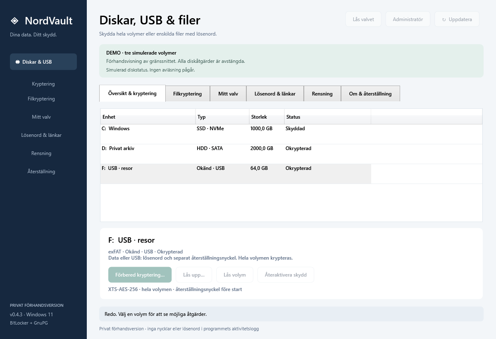
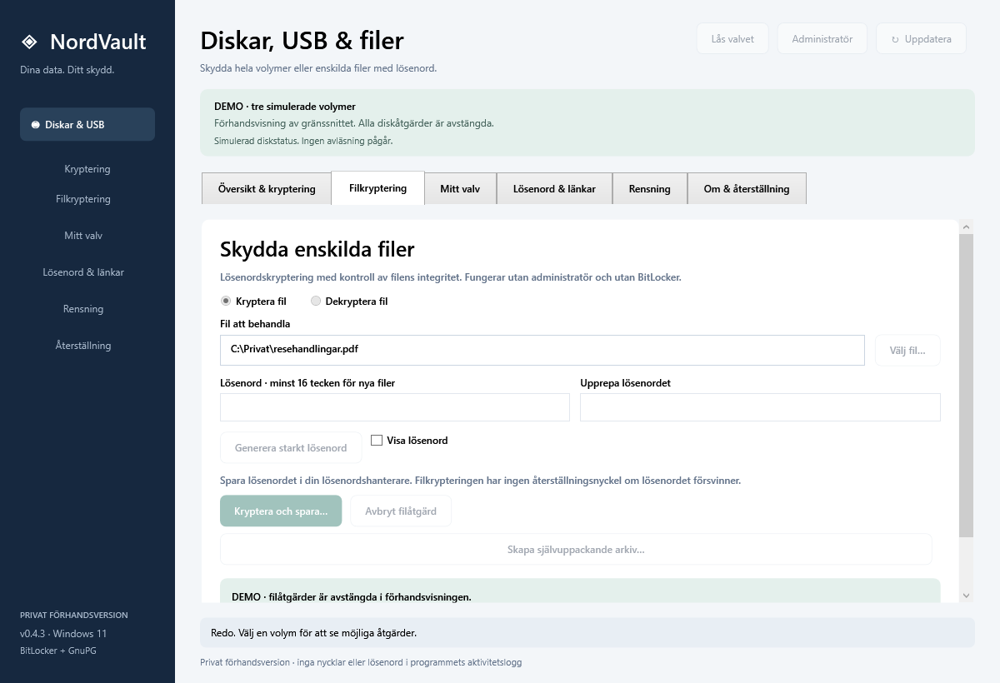
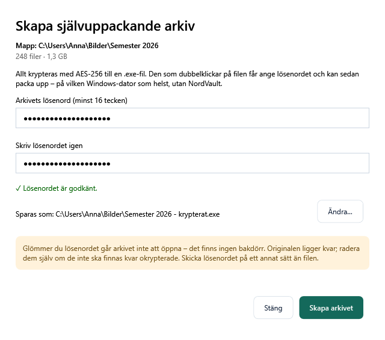
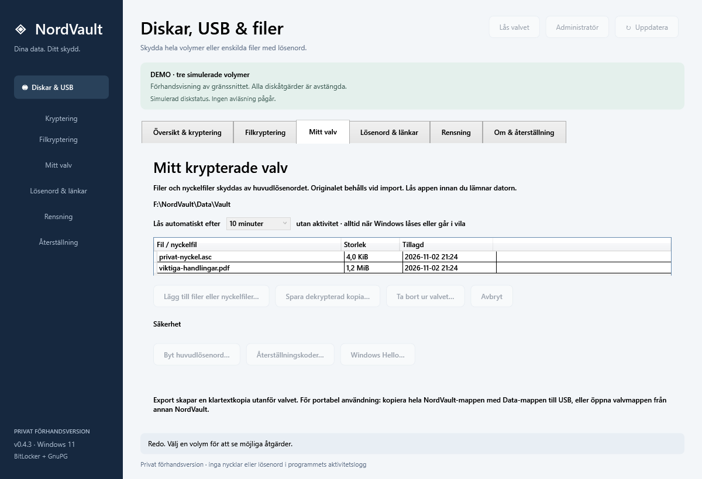
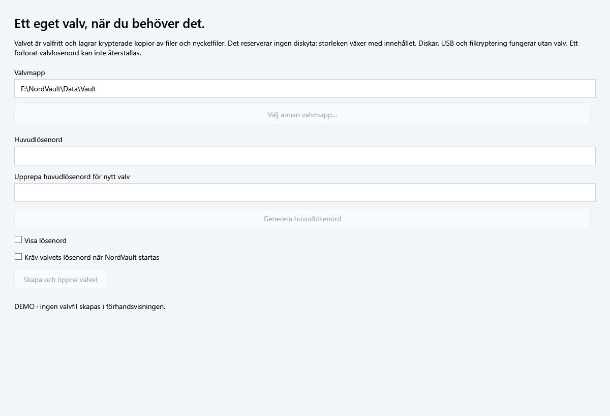
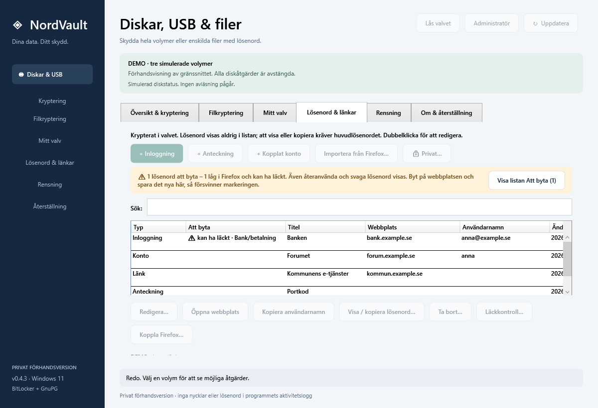
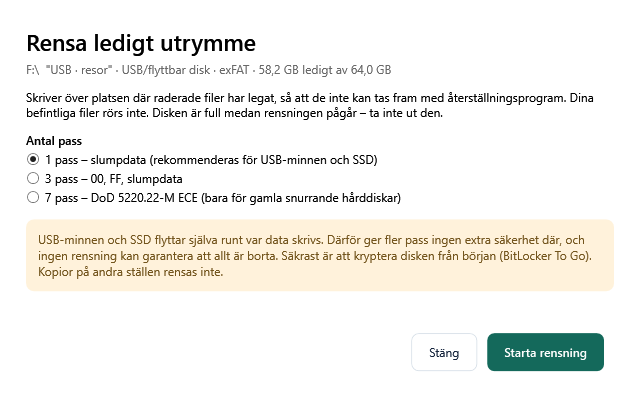
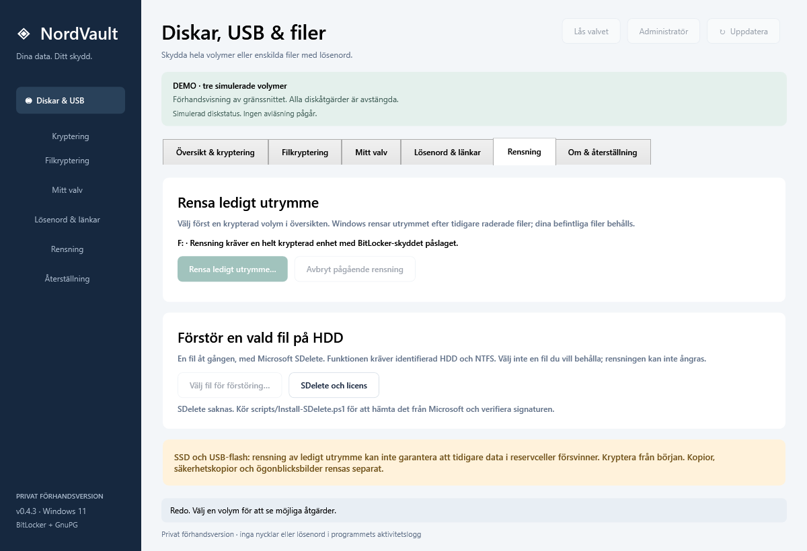

# NordVault

**Svensk säkerhetsapp för Windows 11:** kryptera diskar och USB-minnen, skydda enskilda filer med lösenord, spara lösenord och länkar i ett krypterat valv, logga in i Firefox utan Firefox egen lösenordshanterare, skapa självuppackande arkiv och rensa ledigt utrymme – allt från ett och samma program, på svenska.

NordVault bygger på beprövade motorer i stället för egen kryptografi: **BitLocker** för hela diskar och **GnuPG 2.5** (AES-256, autentiserad OCB) för filer, valv och arkiv.

> **Status:** privat förhandsversion 0.4.3 för Windows 11 x64. Ingen oberoende säkerhetsrevision har gjorts ännu. Appen och installationsprogrammet är inte kodsignerade.



*Alla bilder är tagna i appens demoläge med påhittade diskar, filer och konton.*

---

## Innehåll

- [Funktioner](#funktioner)
  - [Diskar och USB med BitLocker](#diskar-och-usb-med-bitlocker)
  - [Filkryptering](#filkryptering)
  - [Självuppackande arkiv](#självuppackande-arkiv)
  - [Mitt valv](#mitt-valv)
  - [Lösenord, länkar, anteckningar och kopplade konton](#lösenord-länkar-anteckningar-och-kopplade-konton)
  - [Privat](#privat)
  - [Firefox-tillägget](#firefox-tillägget)
  - [Rensa ledigt utrymme](#rensa-ledigt-utrymme)
  - [Högerklick i Utforskaren](#högerklick-i-utforskaren)
- [Säkerhetsmodell](#säkerhetsmodell)
- [Installera](#installera)
- [Bygga från källkod](#bygga-från-källkod)
- [Begränsningar](#begränsningar)
- [Licens](#licens)

---

## Funktioner

### Diskar och USB med BitLocker

- Visar alla diskar och USB-minnen med typ (SSD, HDD, USB), storlek och krypteringsstatus.
- **Förbered kryptering…** krypterar en hel volym med XTS-AES-256. Data- och USB-diskar får ett lösenord, Windows-disken TPM + PIN.
- Återställningsnyckeln måste sparas på en **annan** fysisk enhet. NordVault skriver, läser tillbaka och kontrollerar den innan krypteringen startar.
- Lås upp, lås och återaktivera skydd direkt i appen.
- Kräver Windows 11 Pro, Enterprise eller Education och administratör för diskåtgärder.

### Filkryptering



- Kryptera en enskild fil med ett lösenord (minst 16 tecken) till en `.gpg`-fil. Dekryptera på samma sätt.
- **Generera starkt lösenord** skapar ett slumpat lösenord.
- Hela filen verifieras innan klartext skrivs. Original och befintliga filer skrivs aldrig över.
- Ingen administratör och ingen BitLocker krävs. Upp till 64 GiB per fil.

### Självuppackande arkiv



Som "Self-Decrypting Archive" i gamla PGP:

- Välj en **mapp** eller filer och ett lösenord – NordVault skapar en `.exe`.
- Mottagaren dubbelklickar, anger lösenordet och får tillbaka allt med **undermapparna kvar** – på vilken Windows x64-dator som helst, utan NordVault eller .NET installerat.
- Både innehåll och filnamn är krypterade. Filer körs aldrig automatiskt efter uppackning.
- Upp till 5 000 filer per arkiv. Originalen ligger kvar.

### Mitt valv



- Ett krypterat valv för filer och nyckelfiler (till exempel PGP- eller SSH-nycklar). Filnamn och storlekar krypteras också.
- Låses automatiskt efter 2, 5 eller 10 minuter utan aktivitet, och alltid när Windows låses, går i vila, byter användare eller när skärmsläckaren startar.
- **Säkerhet:**
  - **Byt huvudlösenord…**
  - **Återställningskoder…** – 5 engångskoder om du glömmer huvudlösenordet.
  - **Windows Hello…** – lås upp med fingeravtryck, ansikte eller PIN.
- Valvet är portabelt: kopiera mappen till USB och öppna den med NordVault på en annan dator.



### Lösenord, länkar, anteckningar och kopplade konton



- Spara **inloggningar** (webbplats, användarnamn, lösenord), **anteckningar** och **kopplade konton** (till exempel "loggar in med Google-kontot").
- **Lösenord visas aldrig i listan.** Att visa eller kopiera ett lösenord kräver huvudlösenordet eller Windows Hello igen – även när valvet redan är öppet. Tre fel låser valvet.
- Kopierade lösenord hålls utanför Windows urklippshistorik och molnurklipp och rensas efter 30 sekunder.
- **Lösenordshälsa:** listan *Att byta* visar återanvända, svaga och läckta lösenord, viktigast först (e-post, bank, domäner …).
- **Läckkontroll…** jämför mot Have I Been Pwned med k-anonymitet: bara 5 tecken av en SHA-1-kontrollsumma lämnar datorn.
- **Importera från Firefox…** tar in lösenord (CSV) och bokmärken. Säker import markerar allt importerat som *Att byta*, tar bort hemliga koder ur adresser och visar hur du rensar Firefox efteråt.

### Privat

- Knappen **🔒 Privat…** öppnar en egen avdelning för privata länkar med anteckningar. Den kräver huvudlösenordet eller Windows Hello varje gång.
- Lägg till en länk, klistra in många länkar på en gång, eller flytta in länkar från vanliga listan.
- **Öppna i privat fönster:** Firefox privat fönster, Chrome inkognito eller Edge InPrivate.
- Privata länkar syns aldrig i huvudlistan eller i Firefox-tillägget.

### Firefox-tillägget

- Firefox frågar **Spara lösenordet i NordVault?** när du loggar in – du behöver inte Firefox egen lösenordshanterare eller ett Firefox-konto.
- **Fyll i** kräver att du bekräftar i NordVaults eget fönster (eller med Windows Hello). Lösenordet skickas bara till exakt samma webbplats och bara över https.
- Knappen i verktygsfältet söker bland dina sparade länkar och bokmärken.
- Tillägget pratar bara med NordVault på den egna datorn via Firefox native messaging. Inget skickas till någon server. Varje start kontrollerar att kopplingen i registret inte har ändrats av något annat program.
- Källkoden finns i [`browser/firefox`](browser/firefox).

### Rensa ledigt utrymme



- Skriver över platsen där raderade filer har legat, så att de inte kan tas fram med återställningsprogram. **Befintliga filer rörs aldrig.**
- Välj **1 pass** (slumpdata), **3 pass** (00, FF, slump) eller **7 pass** (DoD 5220.22-M ECE).
- Fungerar på USB-minnen och andra diskar utan BitLocker och utan administratör. Avbryt tar bort allt den skrivit.
- På krypterade BitLocker-volymer finns även Windows egen rensning under fliken **Rensning**.



> USB-minnen och SSD:er flyttar själva runt var data skrivs. Där ger fler pass ingen extra säkerhet, och ingen rensning kan garantera att allt gammalt är borta. Det säkraste är att kryptera disken från början.

### Högerklick i Utforskaren

Högerklicka och välj **NordVault** (i Windows 11 under **Visa fler alternativ**, eller Shift+högerklick):

| Högerklicka på | Val |
|---|---|
| Mapp eller fil | **Skapa självuppackande arkiv…** |
| Disk eller USB-minne | **Rensa ledigt utrymme…** |

Menyn läggs till för din Windows-användare när NordVault installeras eller startas och tas bort vid avinstallation.

---

## Säkerhetsmodell

- **Ingen egen kryptografi.** Diskar krypteras av BitLocker. Filer, valv och arkiv krypteras av en låst version av GnuPG (AES-256, OCB, iterad SHA-512 för lösenordet). GnuPG-filernas kontrollsummor verifieras före varje åtgärd.
- **Öppen källkod är inte en svaghet.** Skyddet bygger på dina lösenord och nycklar, inte på att koden är hemlig.
- **Valvnyckel i kapslar:** valvets innehåll krypteras med en slumpad 256-bitars nyckel. Den kan låsas upp med huvudlösenordet, en återställningskod eller Windows Hello – varje sätt är en egen krypterad kapsel.
- **Skydd även när valvet är öppet:** lösenord hålls förseglade i minnet och kräver ny bekräftelse för att visas, kopieras eller fyllas i. Känsliga fönster döljs vid skärmdumpar och skärmdelning.
- **Inget lämnar datorn** utom läckkontrollens anonyma 5-tecken-förfrågan, och bara när du klickar.
- Mer detaljer: [docs/SECURITY.sv.md](docs/SECURITY.sv.md) och [docs/CRYPTO-REVIEW.sv.md](docs/CRYPTO-REVIEW.sv.md).

---

## Installera

Installationsfiler publiceras inte här ännu. Bygg från källkod enligt nedan.

Installationsprogrammet (`Setup-NordVault-0.4.3.exe`) kan:

- installera för din användare (ingen administratör krävs),
- installera för alla användare,
- packa upp en **portabel version** till exempelvis ett USB-minne.

Uppdateringar behåller valv och egna filer. Avinstallation tar bara bort kända programfiler. Fullständig beskrivning finns i [README.sv.md](README.sv.md).

---

## Bygga från källkod

Krav: Windows 11 x64 och .NET SDK 10.

```powershell
# Hämta och verifiera GnuPG (packas ut utan att installeras)
.\scripts\Install-GnuPG.ps1

# Valfritt: Microsoft SDelete för säker radering av enskilda filer
.\scripts\Install-SDelete.ps1

# Bygg app, tester, installationsprogram och portabel ZIP
.\scripts\Build-Distribution.ps1
```

Bygget kör alla tester – policytester, simulerad BitLocker-backend, riktiga GnuPG-filtester och tester av valv, arkiv och installation. Inga riktiga diskar krypteras eller rensas under bygget.

Förhandsvisning utan några diskåtgärder:

```powershell
.\release\NordVault-Portable\NordVault.exe --demo
```

### Projektstruktur

| Mapp | Innehåll |
|---|---|
| `src/NordVault.Core` | Kryptering, valv, arkiv, lösenord, import, rensning |
| `src/NordVault.App` | WPF-gränssnittet |
| `src/NordVault.Reader` | Läsaren som bäddas in i självuppackande arkiv |
| `src/NordVault.Setup` | Installations- och uppdateringsprogrammet |
| `browser/firefox` | Firefox-tillägget |
| `scripts` | Bygg- och BitLocker-skript |
| `tests` | Tester |
| `docs` | Säkerhet, kryptogranskning, prestanda och källor |

---

## Begränsningar

- Bara Windows 11 x64. Ingen Mac-, Linux- eller ARM-version.
- Ingen oberoende säkerhetsrevision ännu. Appen är inte kodsignerad, så Windows SmartScreen kan varna.
- Ett förlorat huvudlösenord utan återställningskoder går inte att återskapa. Samma sak gäller lösenord för filer och arkiv.
- Rensning och säker radering kan inte garantera att data försvinner från SSD- och flashminnens reservceller.
- Windows Hello fungerar normalt inte via fjärrskrivbord.

---

## Licens

Copyright (C) 2026 exxel-sudo.

NordVault är fri programvara under **[GNU General Public License v3.0](LICENSE)**. Du får använda, granska, ändra och sprida den. Ändrade versioner som sprids måste också ha öppen källkod under GPL-3.0. Programmet levereras utan garantier.

GnuPG har egen GPL-licens. Microsoft SDelete ingår inte och laddas ner separat. NordVault har ingen anknytning till PGP Corporation, Symantec eller Broadcom.
